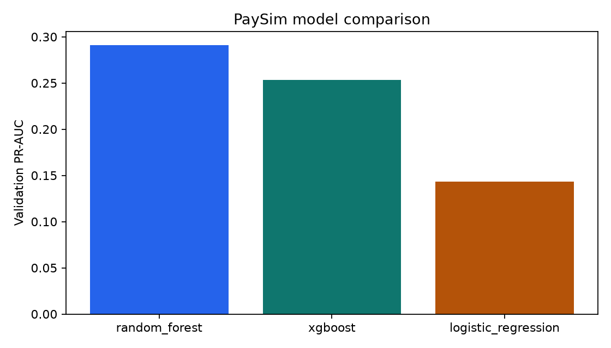
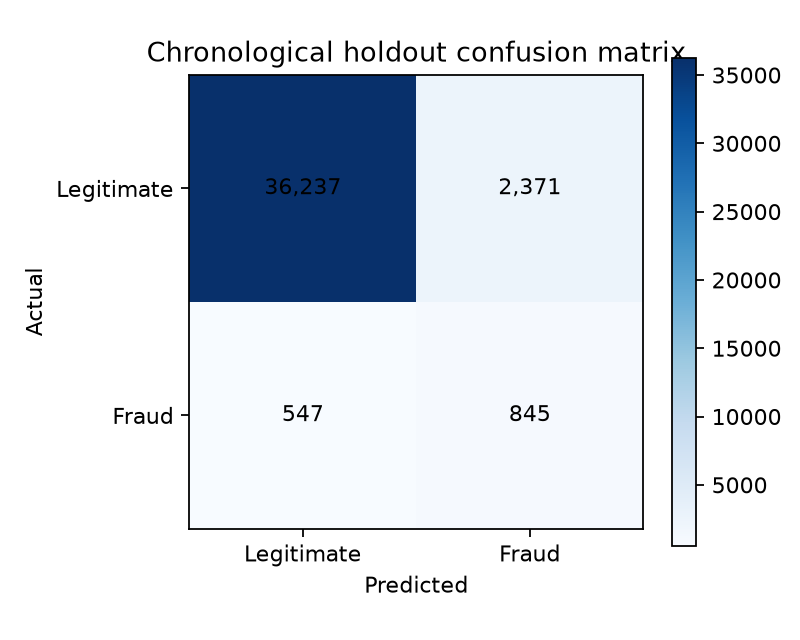

# BANKSIM: four supervised-model comparison

The latest experiment compares **logistic regression, random forest, extra trees, and CatBoost**. Each family has two regularized settings; validation selects its settings and threshold. The four-model winner is frozen before test evaluation. The run was performed locally on the Mac CPU.

Run `python training_model/train.py` from this branch's project root after preparing its raw data. This entrypoint now runs only the four supervised families.

- [Four-model comparison chart](outputs/supervised_search_v1/model_comparison.png)
- [Precision–recall curves](outputs/supervised_search_v1/precision_recall_curves.png)
- [ROC curves](outputs/supervised_search_v1/roc_curves.png)
- [Confusion matrices](outputs/supervised_search_v1/confusion_matrices.png)
- [Training/validation/test gaps](outputs/supervised_search_v1/generalization_gap.png)
- [Threshold trade-offs](outputs/supervised_search_v1/threshold_tradeoffs.png)
- [All metric values](outputs/supervised_search_v1/model_comparison.csv)
- [Protocol, exact results and limitations](outputs/supervised_search_v1/report.json)
- [Training method and commands](training_model/FOUR_SUPERVISED.md)

Four fitted pipelines and `champion.joblib` are in `outputs/supervised_search_v1/`. Existing production checkpoints are retained for comparison. All figures in this section are from the new four-model experiment; the original implementation notes below describe the earlier baseline. Test periods were inspected in earlier experiments; these are exploratory comparisons.

---

## Original project documentation and provenance

# BankSim Synthetic Payment Fraud ML

Standalone PyCharm project for the BankSim agent-based bank-payment dataset. It compares class-weighted
logistic regression, random forest, and CatBoost using a chronological train/validation/test split.
CatBoost keeps the dataset's categorical fields native instead of one-hot expanding them.

## Dataset

- [Canonical Kaggle source](https://www.kaggle.com/datasets/ealaxi/banksim1)
- Synthetic data generated by the BankSim simulator from aggregated Spanish-bank patterns
- Approximately 594,643 transactions with 7,200 fraud labels

The CSV is not redistributed by this repository. Customer IDs, merchant IDs and constant ZIP fields are excluded from the baseline to reduce memorisation and useless features.

## PyCharm setup and run

Open the whole folder, create a Python 3.11 virtual environment, then:

```bash
python -m pip install --upgrade pip
python -m pip install -e ".[dev]"
python scripts/download_data.py
python preprocess_data/run.py
python training_model/train.py
python evaluation/evaluate.py
python -m fraudbench.inference examples/sample_transaction.json
python -m uvicorn fraudbench.api:app --host 127.0.0.1 --port 8050
```

Expected raw file:

```text
data/raw/bs140513_032310.csv
```

## Folder guide

| Folder | Contents |
|---|---|
| `dataset` | Source, citation and expected filename |
| `preprocess_data` | Validation and temporal splitting |
| `preprocessed_df` | Generated model table |
| `training_model` | Training entrypoint |
| `checkpoint` | Selected `.joblib` model |
| `evaluation` | Evaluation entrypoint |
| `outputs` | Metrics, predictions and charts |
| `utils` | Team helper scripts |

## Evaluation design

- Simulation steps are split chronologically before sampling.
- Preprocessing is fitted within the training pipeline.
- Selection and threshold tuning use validation data only.
- The final period is untouched until held-out evaluation.
- PR-AUC is the selection metric because fraud is rare.

## Citation

E. A. López-Rojas and S. Axelsson, “BankSim: A Bank Payment Simulation for Fraud Detection Research,” 2014.

## Current trained result

Logistic regression was selected. On the latest 50,000-row simulation-period sample it achieved PR-AUC **0.7716**, ROC-AUC **0.9923**, precision **0.8757**, recall **0.5870**, and F1 **0.7029**. See [`outputs/metrics.json`](outputs/metrics.json) and [`outputs/model_comparison.csv`](outputs/model_comparison.csv).
CatBoost was evaluated as a third candidate, but its validation PR-AUC (**0.7753**) did not exceed logistic
regression (**0.7850**), so it was not selected.




