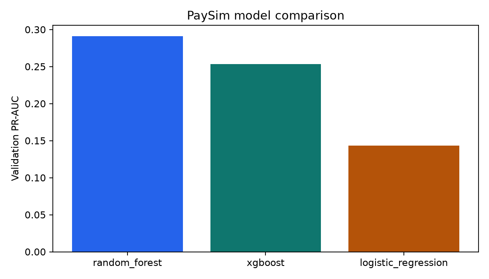
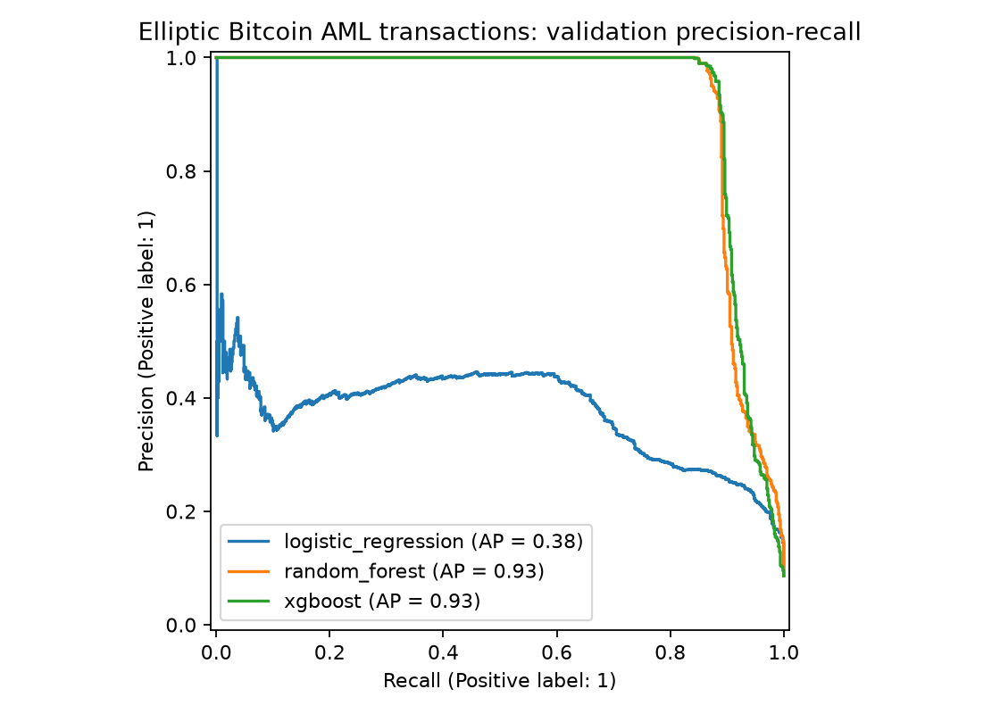
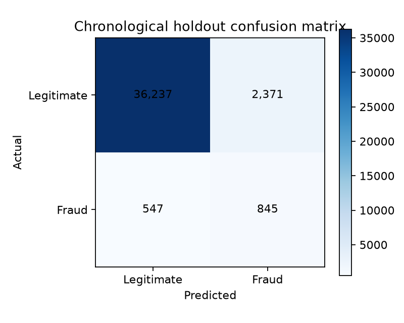

# Latest: four supervised classifiers

[Open all latest metrics and charts](../outputs/supervised_search_v1/)

[Model comparison](../outputs/supervised_search_v1/model_comparison.png) · [PR curves](../outputs/supervised_search_v1/precision_recall_curves.png) · [ROC curves](../outputs/supervised_search_v1/roc_curves.png) · [Metrics CSV](../outputs/supervised_search_v1/model_comparison.csv)

---

# BankSim evaluation

- [Held-out metrics](../outputs/metrics.json)
- [Model comparison table](../outputs/model_comparison.csv)
- [Test predictions](../outputs/test_predictions.csv)

